

  

**AI 에이전트가 쓰는 인터페이스를 만들고, 그 품질을 테스트와 도구로 지키는 개발자입니다.** 
직접 겪은 장애를 재발 방지 도구로 만들고, 그 도구로 다시 제 서버의 버그를 찾아 고쳤어요.

🎓 경북대학교 소프트웨어학과 &nbsp;·&nbsp; 🏦 iM뱅크 데이터 분석 전문가 양성 아카데미 9기 &nbsp;·&nbsp; 📍 대구

 

## ⚙️ Tech Stack

| 분야 | 기술 |
|:---:|---|
| **Language** |    |
| **Server · Tooling** |       |
| **Quality · DevOps** |      |
| **AI · Data** |       |
| **Collaboration** |    |

 

## 🛠 Projects

| 기간 | 프로젝트 | 소속 | 역할 |
|---|---|---|---|
| 2026.11 | 🔍 mcp-agent-lint | 개인 | 설계 · 개발 |
| 2026.11 | 🧧 대구신용보증재단 사주 | 대구신용보증재단 서포터즈 | 기획 · 개발 |
| 2026.10~11 | 🍲 바다거북 수프 추리 게임 | 개인 | 기획 · 개발 |
| 2026.10~11 | 🔮 은퇴 소득 절벽 · 미리사주 | iM뱅크 아카데미 9기 · 팀 투바투 | 데이터 · 모델링 (팀장) |
| 2026.09~10 | 📊 돈독 | iM뱅크 아카데미 9기 · 팀 돈독 | 요구불예금 분석 · 상품 매칭 모델 |
| 2026.08~10 | 🏦 FinHOLLY | iM뱅크 AI·블록체인 공모전 · 팀 아이엠그라운드 | 모델 학습 · 서빙 |
| 2026.07 | 💩 똥폭탄 MCP 서버 | 카카오 PlayMCP 공모전 | 서버 설계 · 개발 |
| 2025.09~2026.05 | 🤟 실시간 한국 수어 번역 | 경북대 졸업 프로젝트 | 모델 · 백엔드 |
| 2025.07~08 | 🍜 김민생 | 팀 프로젝트 | 기획 · 개발 |
| 2025.07~11 | 💗 티가나 | DX 캠프 · 팀 프로젝트 | 기획 · 개발 · 서비스화 |
| 2025.05~2026.03 | 🌱 SPORE | const::std 동아리 · 팀 SPORE | 백엔드(Firebase) · 친구 기능 · Play 배포 |
| 2025.05~06 | 🌿 이든길 | 경북대 SW 파이썬 프로젝트 · 4인 | 데이터 수집 · 분석 |

▼ 프로젝트 이름을 누르면 상세 내용이 펼쳐집니다.

<b>🔍 mcp-agent-lint</b> — MCP 서버를 AI 에이전트의 눈으로 검사하는 CLI

 

<table>
<tr><td> 똥폭탄 서버를 처음 검사했을 때 — 로컬에서 이미지 링크가 전부 깨져 있었음</td></tr>
<tr><td> 수정 후 — 이제 똥폭탄 CI가 push마다 같은 검사를 돌림</td></tr>
</table>

> 사람이 화면으로 테스트하면 안 보이고, 에이전트가 실제로 호출해야 드러나는 문제를 잡는 도구 · 개인 프로젝트 · 2026.11

#### 🎯 왜 만들었나
똥폭탄 MCP 서버를 만들면서 **base64 이미지 응답 때문에 에이전트의 답변 생성이 실패**하는 장애를 겪었어요. 사람용 UI에는 린터가 많지만 "에이전트가 쓰는 인터페이스"를 검사하는 도구는 없어서, 같은 문제를 다시 겪지 않도록 도구로 만들었습니다.

#### 💡 어떻게 동작하나

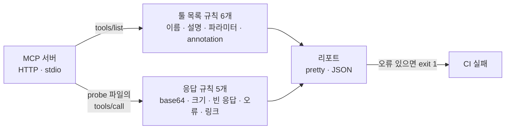

| 규칙 | 잡는 것 |
|---|---|
| `tool-name` · `tool-description` · `param-description` | 에이전트가 이름만 보고 추측해야 하는 툴과 파라미터 (중첩 객체 · 배열 항목까지) |
| `annotations` | `readOnlyHint` · `destructiveHint`가 없어 호스트가 모든 호출을 위험하게 취급하는 경우 |
| `response-inline-binary` | 응답 속 이미지 · 오디오 블록, base64 문자열 — 똥폭탄 장애의 원인 |
| `response-size` · `response-empty` | 에이전트가 읽기엔 너무 크거나, 전할 말이 없는 응답 |
| `response-broken-link` | 응답 속 링크가 실제로 열리지 않는 경우 |

#### 📈 결과
- **첫 실행에서 진짜 버그 발견** — 똥폭탄 서버가 프록시 헤더가 없으면 이미지 URL을 `https`로 고정해, 로컬에서는 모든 이미지 링크가 깨져 있었음 → 수정 후 똥폭탄 CI에 이 도구를 붙여 push마다 검사
- 테스트 71개를 세 층으로 — 규칙 단위 / 메모리 안의 실제 MCP 서버 / 실제 프로세스로 띄운 stdio · HTTP 서버
- Node 20 · 22 · 24 CI에서 **패키지로 묶어 설치한 CLI**가 동작하는지까지 확인

#### 🔧 설계에서 신경 쓴 점
- **안전장치 먼저** — 실제 서버에 호출을 보내는 도구라, 파괴적일 수 있는 툴은 `--allow-destructive` 없이 호출하지 않고, 없는 툴이나 잘못된 규칙 이름은 아무것도 호출하기 전에 종료 코드 2로 멈춤
- **에이전트 입장에서 오류 통일** — 서버가 `isError` 결과를 주든 JSON-RPC 오류를 던지든 같은 "실패"로 처리
- **테스트하다 찾은 내 버그** — 문장 끝 쉼표가 붙은 URL(`…jpg,`)을 깨진 링크로 잘못 판정하던 문제, `xxxx…` 같은 반복 문자를 base64로 오인하던 문제를 테스트로 잡아 수정
- 런타임 의존성은 MCP SDK와 zod 2개뿐, `strict` + `noUncheckedIndexedAccess` + ESLint `strictTypeChecked`

**Stack** · TypeScript · Node.js · MCP SDK · zod · Vitest · ESLint · GitHub Actions

<b>🧧 대구신용보증재단 사주</b> — 재단의 30년을 사주로 풀어낸 SNS 홍보 콘텐츠

 

<table>
<tr><td colspan="2"> 링크 공유 미리보기 카드</td></tr>
<tr>
<td width="50%"> 재단의 30년을 年 · 月 · 日 · 時 네 기둥으로</td>
<td width="50%"> 7문항 사업가 테스트 결과</td>
</tr>
</table>

> 딱딱한 기관 실적은 SNS에서 끝까지 읽히지 않아서, 1996년에 세워진 재단을 "올해 서른 살이 된 아이"로 보고 사주 캐릭터가 30년을 풀어 주는 콘셉트로 기획 · 대구신용보증재단 서포터즈 · 2026.11

#### 🎬 흐름

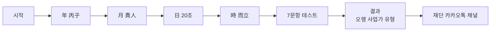

| 기둥 | 한마디 | 담은 실적 |
|:-:|---|---|
| **年** 丙子 | 혼자 크는 팔자가 아니다. 남과 함께 크는 팔자다. | 소상공인의 보증인 |
| **月** 貴人 | 세상이 흔들릴 때마다 남의 버팀목이 되었구나. | 2020 코로나19 금융안전망 |
| **日** 20조 | 말보다 숫자가 정직하지. | 경영실적평가 2년 연속 1위 |
| **時** 而立 | 새 집으로 옮기면 운의 그릇이 커진다. | 보증 → 종합금융 허브 |

- **한 화면에 한 장면** — 스크롤 없이 버튼으로 넘기고, 360×640 작은 휴대폰 화면까지 확인
- 읽고 끝나지 않게 **7문항 사업가 테스트**로 이어서, 유형별 재단 지원 키워드와 카카오톡 채널로 연결
- 답변은 저장하지 않고 브라우저 안에서만 계산, 결과 복사로 SNS 공유

**Stack** · HTML · CSS · JavaScript · GitHub Pages

<b>🍲 바다거북 수프 추리 게임</b> — LLM이 사회자가 되는 예/아니오 추리 게임

 

<table>
<tr>
<td width="50%"> 손잡이를 돌리면 불이 붙고 수프가 끓어요</td>
<td width="50%"> 장르와 사건 고르기 · 이어하기</td>
</tr>
<tr>
<td width="50%"> 질문하면 사회자가 도장을 찍어 답하고, 사건 노트에 추리를 적어요</td>
<td width="50%"> 진상을 쓰면 정답 / 거의 맞음 / 아직으로 채점</td>
</tr>
<tr>
<td width="50%"> 효과음 · 점화 효과 · 큰 글씨 설정</td>
<td width="50%" align="center">  모바일 — 카드가 한 줄로 쌓이고 사건 노트는 버튼으로</td>
</tr>
</table>

> *"부장은 원샷했는데 살았고, 과장은 한 모금 마시고 쓰러졌다. 왜?"* — 이상한 사건 하나를 예/아니오 질문만으로 풀어요 · 진상을 알고 있는 사회자를 LLM이 맡아요 · 개인 프로젝트 · 2026.10~11

#### 🤖 LLM을 게임 규칙 안에 가두기

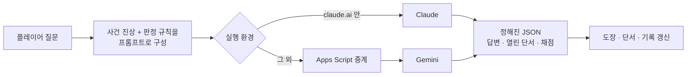

- LLM이 자유롭게 말하지 않고 **정해진 JSON(답변 종류 · 열린 단서 번호 · 채점)으로만 답하게** 해서, 판정이 화면의 도장과 단서 칸에 정확히 맞물림
- JSON이 깨지면 본문에서 다시 추출하고, 그래도 안 되면 오류로 처리해 게임이 멈추지 않게
- 사회자는 다섯 가지 도장으로만 답하고, 예/아니오로 답할 수 없는 질문엔 "다시"

#### 🎮 게임 설계
- 질문 35개 · 힌트 3개(10 · 20 · 30번째 질문에 열림) · 핵심 단서 6칸
- 이어하기와 사건 노트는 브라우저(`localStorage`)에만 저장, 큰 글씨 · 효과음 · 점화 효과 끄기 등 접근성 옵션
- 빌드 없이 `index.html` 하나로 실행

**Stack** · HTML · CSS · JavaScript · Claude · Gemini (Apps Script 중계)

<b>🔮 은퇴 소득 절벽 · 미리사주</b> — 지금은 괜찮은 50~69세 중 2년 뒤 빈곤선 아래로 떨어질 사람을 미리 찾는 머신러닝

 

> 🔗 **[미리사주 직접 해 보기 → nohulab.github.io/front_E](https://nohulab.github.io/front_E/)**

<table>
<tr>
<td width="50%"> 미리사주 — 시작 화면</td>
<td width="50%"> 21문항 입력</td>
</tr>
<tr>
<td width="50%"> 결과 — 위험 구간 · 이유 3가지 · 같은 자리 100명 중 하락 비율</td>
<td width="50%"> 상담 챗봇 — 대화에서 입력값을 뽑아 채움 (Claude API)</td>
</tr>
<tr>
<td colspan="2"> 다음 걸음 — 복지로 · 고용24 · 국민연금공단 등 공식 사이트만 안내</td>
</tr>
<tr>
<td width="50%"> 15종 모델 비교 (가처분 3개 패널 평균 시험 AUC)</td>
<td width="50%"> 같은 인원을 살폈을 때 찾은 하락자 수 (+18~32%)</td>
</tr>
</table>

> 기존 노후 진단이 '괜찮다'고 판정한 사람의 10.4%가 이후 빈곤선 아래로 반복해 떨어졌고, 그중 약 95%는 기초생활보장 수급 기록이 없었어요 · iM 디지털 뱅커 아카데미 9기 · 팀 투바투(4인) · 담당: **팀장, 데이터 총괄 · 모델링** · 2026.10~11

#### 🎯 문제 정의
노후 계산기는 "지금 소득 + 앞으로 받을 연금 ≥ 필요한 생활비"를 **지금의 숫자**로만 판단해요. 소득이 출렁이는지, 일이 끊기는지, 연금 개시 전 공백이 있는지 같은 **흐름**은 못 봐요. 이 빈틈을 머신러닝으로 채웠습니다.

#### 🧠 데이터와 모델

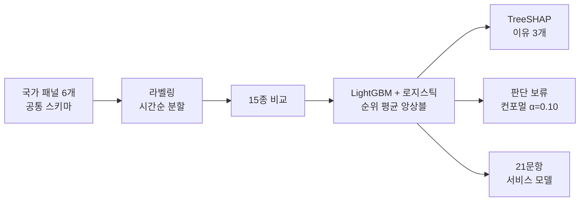

- 같은 사람을 추적하는 국가 패널 6개를 변수 이름 · 물가 · 기준선 · 라벨 정의까지 맞춰 통합(학습 103,864행 · 시험 31,544행), 과거로 학습하고 최근 연도로 시험
- 소득 흐름(최근 변화 · 3년 중 최저 · 변동성) · 연금 개시까지 남은 해 · 일자리 · 가구 변화 · 재산 완충을 변수로 설계
- **AUC 0.811 → 0.870**, 같은 인원을 살폈을 때 찾은 실제 하락자 **192 → 226명(+18%)**, 21문항 서비스 모델도 0.868로 전체 모델과 0.001 차이

#### 🧪 외운 게 아니라 배웠나
- **실험 전에 통과 기준을 사전 등록**하고 그대로 판정
- 보고서의 설계도와 실제 코드가 맞는지 자동 검정(전체 26개 · 모델별 91개), 학습 모델과 배포 모델의 일치 시험(합성 300건)
- 라벨을 섞으면 AUC 0.45~0.51로 떨어지는지, 다른 5개 패널에 그대로 옮겨도 나은지, 성별 · 학력 · 나이 · 취업 · 가구 형태 모든 하위 집단에서 나은지 확인

#### 🔮 서비스
- 20여 개 입력의 이탈을 줄이려고 노후 진단을 **사주 콘셉트**로 바꿈 — 내 미래가 궁금해 끝까지 입력하고 결과를 꼼꼼히 읽는 심리 활용
- 확신이 낮을 땐 결론을 아끼는 **판단 보류**, 이유 3가지, 공공기관 공식 사이트로만 연결
- 입력은 저장하지 않고, 서버는 요청 본문을 로그에 남기지 않음
- A/B 테스트 후 SNS 홍보로 하루 조회 600 · 좋아요 500

**Stack** · Python · LightGBM · scikit-learn · SHAP · FastAPI · Docker · Claude API

<b>📊 돈독 (Don-Ddok)</b> — 수출 경기 충격의 법인 계좌 전이 분석 · 기업금융 상품 매칭

 

<table>
<tr><td> 수출 증감률 10%p 하락 후 계정별 누적 변화 — 실선이 외환 노출 법인. 요구불예금만 뚜렷하게 내려감</td></tr>
<tr><td> 예금 종류별 노출 · 비노출 법인 차이 — 요구불은 줄고 거치식 · 적립식은 늘어남</td></tr>
<tr><td align="center"> 공식 수출 통계로 국면을 판정하는 트리거 (경북 · 대구)</td></tr>
</table>

> 지역 수출이 꺾이면 그 충격이 지방은행 법인 계좌에 언제, 어디에, 얼마나 나타나는지 검증하고 영업 현장의 상품 상담 우선순위로 연결 · iM 디지털 뱅커 아카데미 9기 · 팀 돈독 · 담당: **요구불예금 분석, 상품 매칭 모델** · 2026.09~10 
> **팀 결과**: 수출 증감률이 10%p 떨어지면 외환 노출 법인의 요구불예금이 6개월 뒤 약 3.6% 낮아짐 (Holm 보정 후에도 유의 · 사전추세 없음 · 검정력 약 87%)

#### 📉 담당 — 요구불예금 분석
- iM뱅크 익명 법인 데이터 11,036곳 × 36개월과 공식 수출 통계(K-stat · 관세청 HS4)를 결합
- 이중차분 · 국소투영(h=0~12) · 법인 · 연월 이중 군집 표준오차 · Holm 보정을 기본으로, 성향점수매칭 · wild cluster bootstrap · 위약 검정 · 사전추세 점검 · 최소검출효과까지 확인
- 팀이 본 6개 경로(요구불 · 적립식 · 거치식 · 운전자금 대출 · 입출금 · 무역 실적) 중 **유일하게 전이가 확인된 계정**
- 수입만 하는 법인 509곳에서도 −4.2%가 나와, 수출 기업만의 현상이 아님을 확인
- 영업일수 달력을 두 출처로 교차검증(r = 1.000)하고, 금액 단위 오인으로 효과가 작게 잡히던 문제를 찾아 통일

#### 🧩 담당 — 상품 매칭 모델

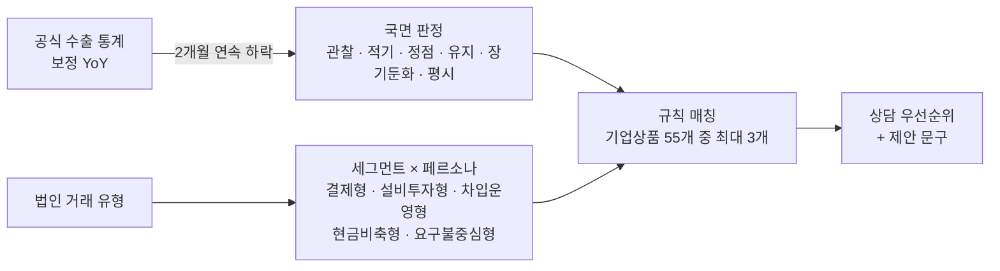

- 은행 데이터로 경기 둔화를 **예측**하는 신호는 위약 검정을 통과하지 못해, 무리하게 예측 모델을 만들지 않고 **공식 수출 통계를 트리거로, 은행 데이터는 고객 분류에만** 쓰는 구조로 전환
- iM뱅크 기업상품 55개를 수집해 국면 × 페르소나별로 매핑하고, 담당자가 바로 쓸 수 있는 제안 문구까지
- 판정이 **2개월 연속 같을 때만** 페르소나를 바꿔(히스테리시스) 한 달 사이 A → B → A로 오락가락하는 문제를 없앰
- 상담 우선순위는 요구불 규모 70% + 최근 3개월 감소폭 30% — 규모는 작아도 최근 사정이 나빠진 법인이 위로 올라오게

#### 🔐 데이터 보호
원본 · 가공 데이터는 `.gitignore`로 저장소에서 원천 차단하고, 공개한 결과물은 모두 집계 수치. 5곳 미만 그룹 · 최댓값 · 법인 ID는 가려서 개별 법인을 역추적할 수 없게 했어요.

**Stack** · Python · pandas · statsmodels · 패널 회귀 · 규칙 기반 매칭(YAML)

<b>🏦 FinHOLLY</b> — 은행 내부망에서만 도는 금융 특화 번역 AI

 

<table>
<tr><td align="center"> ▶ 시연 영상 (YouTube)</td></tr>
</table>

> 고객 정보를 외부 번역 API로 보낼 수 없는 은행 창구를 위해, 한국어 금융 문서를 동남아 5개 언어로 **내부망 안에서만** 번역 · iM뱅크 AI & 블록체인 공모전 출품작 · 팀 아이엠그라운드 · 2026.08~10

#### 🎯 풀고 싶었던 문제
1. **보안** — 개인정보와 거래정보가 담긴 문서를 외부 API로 보낼 수 없음
2. **금융 용어** — 일반 번역기는 금융 맥락의 단어를 자주 틀림

| 한국어 | 금융 맥락의 뜻 | 일반 번역기가 자주 하는 실수 |
|:-:|---|---|
| **청산** | 계약 · 포지션을 정리하고 결제함 | 빚이나 관계를 "깨끗이 정리함" |
| **모집** | 투자자에게 증권을 공모함 | 사람을 "뽑음", "모음" |
| **사모** | 소수 투자자 대상 비공개 발행 | "그리워함(思慕)"으로 오역 |

#### 💡 구조

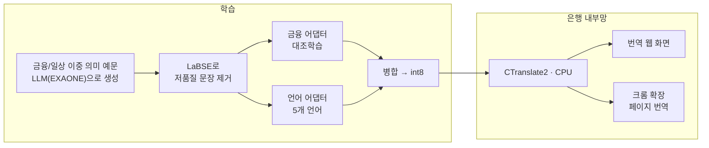

- **대조학습(SupCon)** — 같은 단어라도 금융 의미와 일상 의미를 서로 멀어지게 학습. 같은 용어의 예문을 한 배치에 모으는 샘플러를 직접 만들어 대조 손실이 제대로 작동하게
- **조합형 LoRA** — 금융 어댑터와 언어 어댑터를 분리해, 새 언어는 언어 어댑터만 학습하면 됨
- **LLM 데이터를 믿지 않고 검증** — LLM으로 만든 학습 문장을 LaBSE 임베딩으로 원문-번역 정렬을 확인해 자동 제거, 학습에 없던 용어(청산 · 사모 · 모집)로 일반화 평가, FLORES-200 · sacreBLEU로 품질 측정

#### 🖥 현장에서 쓸 수 있게
- int8 양자화로 **GPU 없이 CPU에서 문장당 0.1~0.3초**
- `install.bat` → `실행.bat` 더블클릭 두 번, 인터넷이 없는 폐쇄망 PC용 오프라인 설치
- 모델은 폴더만 바꿔 끼우면 되고, 지원 언어는 설정 파일 한 곳에서 관리
- 레이아웃은 그대로 두고 글자만 바꾸는 크롬 확장, "원문 보기"로 되돌리기

**Stack** · Python · PyTorch · NLLB-200 · LoRA · CTranslate2 · Flask · Chrome Extension (MV3)

<b>💩 똥폭탄 MCP 서버</b> — 카카오톡 단톡방에서 AI 에이전트가 진행하는 게임

 

<table>
<tr>
<td width="36%"> 똥폭탄</td>
<td>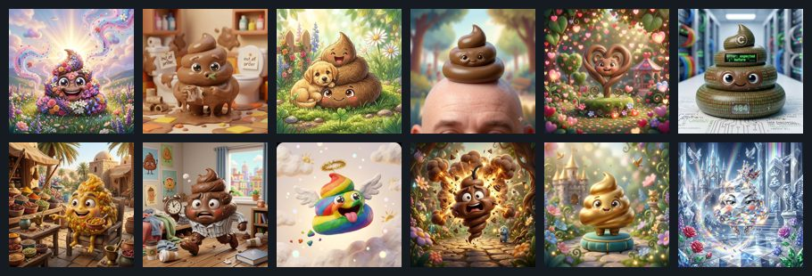 28종 똥 도감 중 일부 — 일반 24종 + 무지개 · 폭탄 · 황금 · 다이아</td>
</tr>
<tr>
<td colspan="2">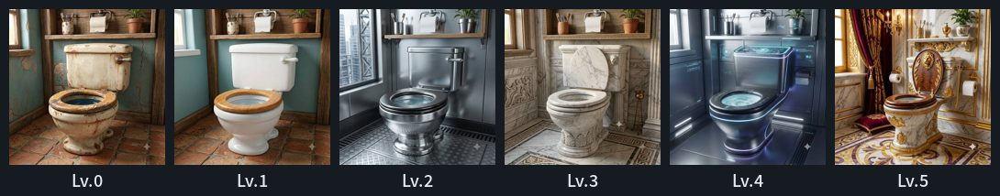 변기 강화 Lv.0 → Lv.5 — 레벨이 오를수록 물 내리기 성공률 60% → 85%</td>
</tr>
<tr>
<td colspan="2">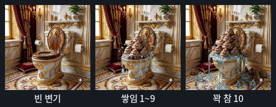 똥이 쌓인 정도에 따라 바뀌는 그림 — 꽉 차면 불운이 와서 코인을 못 벌어요</td>
</tr>
</table>

> 카카오 PlayMCP 공모전 「Agentic Player 10」 출품작 · AI 에이전트가 호출하는 MCP 툴 8개를 설계·구현 · 2026.07

#### 🎮 게임
단톡방 친구에게 똥을 던지면 상대 변기에 똥이 쌓이고, 꽉 차면 불운이 찾아와요. 변기를 내리고, 강화하고, 반격하면서 28종 도감과 10종 스킨을 모아요. 대상을 비우면 **마지막으로 나를 때린 사람에게 자동으로 복수**해서, 에이전트가 대상을 못 알아들어도 게임이 이어지게 했어요.

#### 🔥 트러블슈팅 — 응답 속 base64 이미지

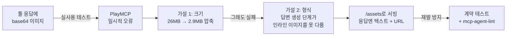

- 이미지를 모두 512×512 · JPEG 70으로 다시 인코딩해 장당 100KB 미만으로 줄였는데도 같은 오류 → 크기가 아니라 **형식**이 원인이라고 다시 판단
- 이미지는 `/assets`로 서빙하고 툴 응답에는 텍스트와 URL만 담아 해결. 그 과정에서 확장자는 `.png`인데 실제로는 JPEG인 파일도 찾아 고침
- **같은 그림도 받는 쪽에 맞게** — 에이전트(`/mcp`)에는 텍스트 속 URL, 사람이 보는 카카오 채팅 화면(`/skill`)에는 정식 이미지 블록

#### 🧪 재발 방지
- 실제 MCP 클라이언트로 서버에 붙는 **계약 테스트** — 모든 툴 응답이 텍스트 블록 1개 · 2,000자 미만 · base64 없음인지, 응답 속 이미지 URL이 실제 파일을 가리키는지
- **설계 문서 ↔ 코드 대조 테스트** — `DESIGN.md`의 툴 명세 표와 강화 확률 표를 직접 읽어서 실제 서버 · 상수와 다르면 실패
- 확률은 `Math.random()`을 고정해 경계값(75% · 87% · 95% · 99%)까지 검증, 테스트 110개
- 런타임 취약점 9개 → 0개, Dependabot, CI에서 HTTP 스모크 테스트와 mcp-agent-lint 검사

#### 🏗 구조
- **Stateless 서버** — PlayMCP 가이드에 맞춰 요청마다 새 MCP 서버를 만들고, 상태는 전부 SQLite(WAL)에
- **Repository 패턴** — 서버가 여러 대로 늘면 Postgres로 바꿀 수 있게 DB 접근을 한 겹 감쌈
- **방별 독립 상태** — 같은 사람도 단톡방마다 코인 · 변기 · 도감이 따로

**Stack** · TypeScript · Express · MCP SDK · SQLite · Docker · Vitest · GitHub Actions

<b>🤟 실시간 한국 수어 번역</b> — 카메라 앞에서 수어 단어와 지문자를 실시간으로 읽는 서비스

 

<table>
<tr><td align="center"> ▶ 시연 영상 (YouTube)</td></tr>
<tr><td>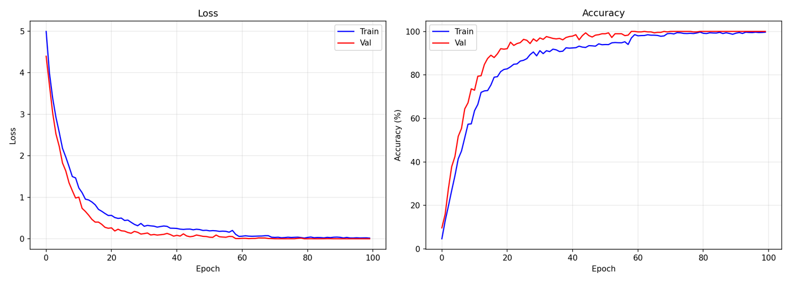 단어 모델 학습 곡선</td></tr>
</table>

> 수어 단어(영상)와 지문자(손 모양)를 웹캠으로 실시간 인식해요 · 경북대학교 졸업 프로젝트 · 담당: **모델 · 백엔드** · 2025.09~2026.05

#### 💡 어떻게 동작하나

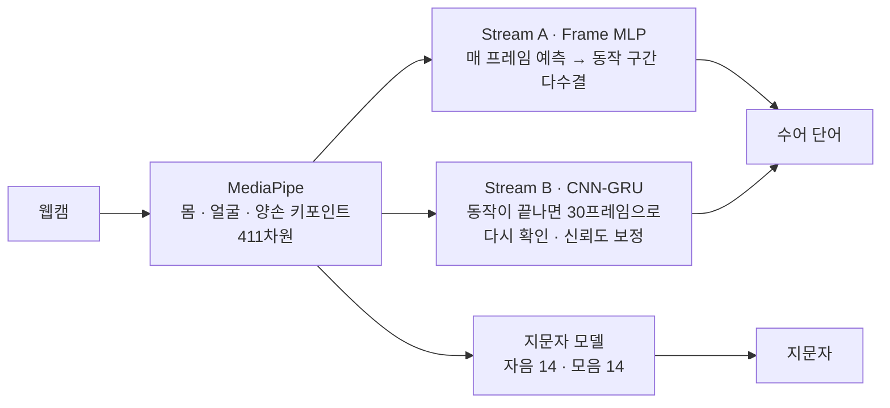

- **두 갈래(Dual Stream) 인식** — 빠른 Frame MLP가 매 프레임 결과를 내고, 동작이 끝나면 CNN-GRU가 시퀀스 전체를 보고 한 번 더 확인. CNN-GRU 파일이 없으면 MLP 단독으로도 동작
- **411차원 키포인트** — 몸(25) · 얼굴(70) · 왼손(21) · 오른손(21) 랜드마크를 한 벡터로. 지문자는 손 가중치 0.99, 몸 · 얼굴 0.005로 손 모양에 집중
- **데이터 파이프라인** — 국립국어원 한국수어사전 영상 수집(Selenium) → 영상 · 사진을 키포인트 JSON으로 변환 → 학습
- 직접 촬영한 영상 · 사진에는 얼굴과 몸이 담겨 있어 데이터는 저장소에서 제외

#### 🔍 스스로 찾은 한계와 다음 단계
- 데이터를 6배로 증강한 **뒤에** 학습 · 테스트를 나눠, 같은 영상의 변형본이 양쪽에 함께 들어감 → 테스트 정확도 100%가 실제보다 높게 나왔을 가능성. **원본 영상 단위로 먼저 나누고 학습셋에만 증강**하도록 바꿀 계획
- `다시1` · `다시2`처럼 촬영 번호가 붙은 폴더가 다른 단어로 분류되는 라벨 문제, 처음 보는 수화자에 대한 성능 점검

**Stack** · Python · PyTorch · MediaPipe · OpenCV · Selenium

<b>🍜 김민생</b> — 민생회복 소비쿠폰을 쓸 수 있는 가게를 대신 찾아 주는 서비스

 

> 소비쿠폰을 받았는데 어느 가게에서 쓸 수 있는지 찾기 어렵다는 데서 출발했어요. 사장님들이 네이버 지도 '소식' 탭에 올린 "소비쿠폰 사용 가능합니다!" 공지를 자동으로 모아 한곳에서 보여줘요 · 팀 프로젝트 · 담당: **기획 · 개발**

#### 🤖 수집 흐름

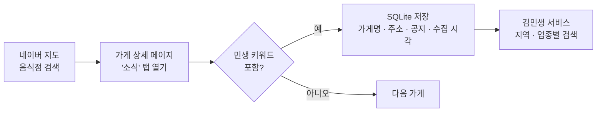

| 가게 | 지역 | 공지 내용 |
|---|---|---|
| 연남토마 성수점 | 성동구 | 민생회복 소비쿠폰 사용가능합니다! |
| 샤브올데이 서울고척점 | 구로구 | 📢 민생회복 소비쿠폰 사용 가능 안내 |
| 취링취링 화곡역 본점 | 강서구 | 민생회복 소비쿠폰 사용가능 |

시험 수집 결과 일부 — 서울 11개 자치구 25곳

- 무한 스크롤 검색 결과와 페이지 넘김 검색 두 가지 크롤러, 키워드(`민생지원금` · `민생회복` · `민생 쿠폰` · `소비쿠폰` 등)는 파일로 따로 관리
- 사이트에 부담을 주지 않도록 요청 사이에 대기 시간, 어느 폴더에서 실행해도 같은 DB에 쌓이게
- 사장님이 직접 가게를 등록 · 관리하는 기능, 기기 안에만 저장되는 즐겨찾기, 개인정보 처리방침 페이지

**Stack** · Python · Selenium · SQLite

<b>💗 티가나</b> — 얼굴 대신 키워드로 먼저 만나는 익명 매칭 앱 (DX 캠프 · Google Play 출시 · 운영)

 

<table>
<tr><td width="34%"> 티가나</td>
<td>

> 사진 한 장으로 판단하는 소개팅 앱 대신, 처음엔 **얼굴 대신 키워드**로 서로를 알아가고 **두 사람이 모두 동의했을 때** 진짜 프로필을 공개해요 · DX 캠프 팀 프로젝트(2025.07~11) · 2025년 Google Play에 출시해 운영 (현재 서비스 종료) · 담당: **기획 · 개발 · 서비스화**

</td></tr>
<tr><td colspan="2">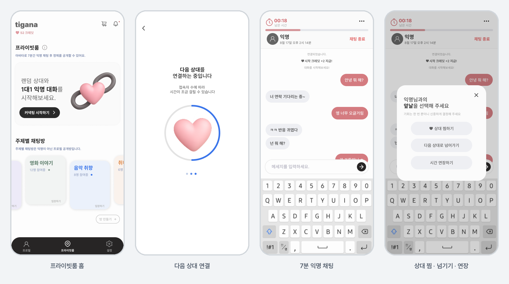 프라이빗룸 홈 → 다음 상대 연결 → 7분 익명 채팅 → 끝나면 상대 찜 · 넘기기 · 시간 연장 중 하나를 골라요</td></tr>
<tr><td colspan="2">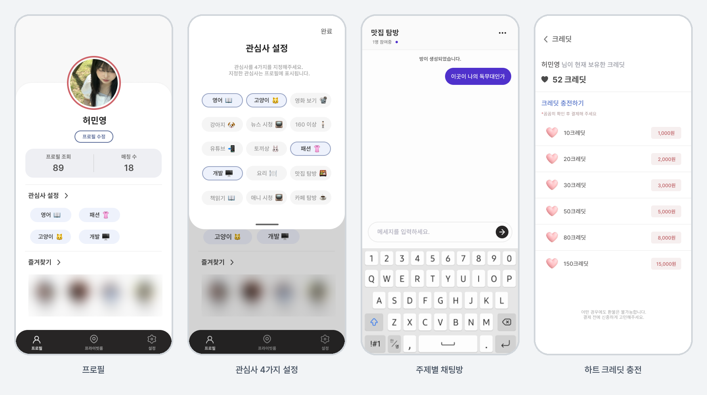 관심사 4가지로 만드는 프로필, 프로필을 공개하고 대화하는 주제별 채팅방, 하트 크레딧 충전 (다른 사용자의 사진 · 이름은 흐리게 처리)</td></tr>
</table>

#### 🔄 매칭 흐름

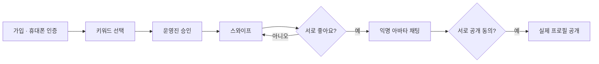

| 기능 | 설명 |
|---|---|
| 🏷️ 키워드 프로필 | 대표 키워드 · 인생 영화 · 좋아하는 장소 · 자유 키워드, 원형 사진 + 4칸 카드 |
| 💌 스와이프 매칭 | 좋아요 / 넘기기, 서로 좋아요면 매칭 |
| 🎭 익명 아바타 채팅 → 🔓 상호 동의 공개 | 대화가 통한 뒤에 두 사람 모두 동의해야 실제 프로필 공개 |
| 💗 하트 크레딧 | 카카오페이로 충전하는 앱 내 크레딧 |
| 📱 휴대폰 인증 · 가입 승인 · 🛠️ 관리자 | 본인 인증과 운영진 승인, 회원 · 결제 · 통계 관리 |

- 클라이언트와 서버가 **DB 스키마(Drizzle + Zod)를 공유**하는 풀스택 TypeScript 구조
- 비밀번호는 bcrypt, DB 접근은 storage 계층으로 분리
- 스토어 출시를 위해 **개인정보 처리방침 · 계정 삭제 안내 페이지를 직접 작성해 운영**

**Stack** · TypeScript · React · Vite · Tailwind · shadcn/ui · Express · Drizzle ORM · PostgreSQL · KakaoPay · Google Play

<b>🌱 SPORE</b> — 심리테스트로 캐릭터를 찾고, 친구와 시간표를 공유하는 대학생 앱

 

<table>
<tr><td>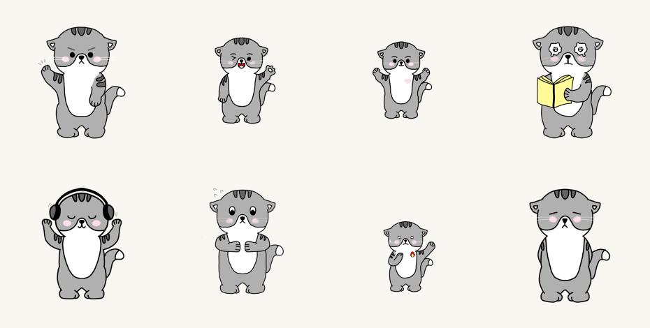 심리테스트 결과로 만나는 8가지 캐릭터 — 프로필 사진으로도 쓰여요</td></tr>
<tr><td align="center">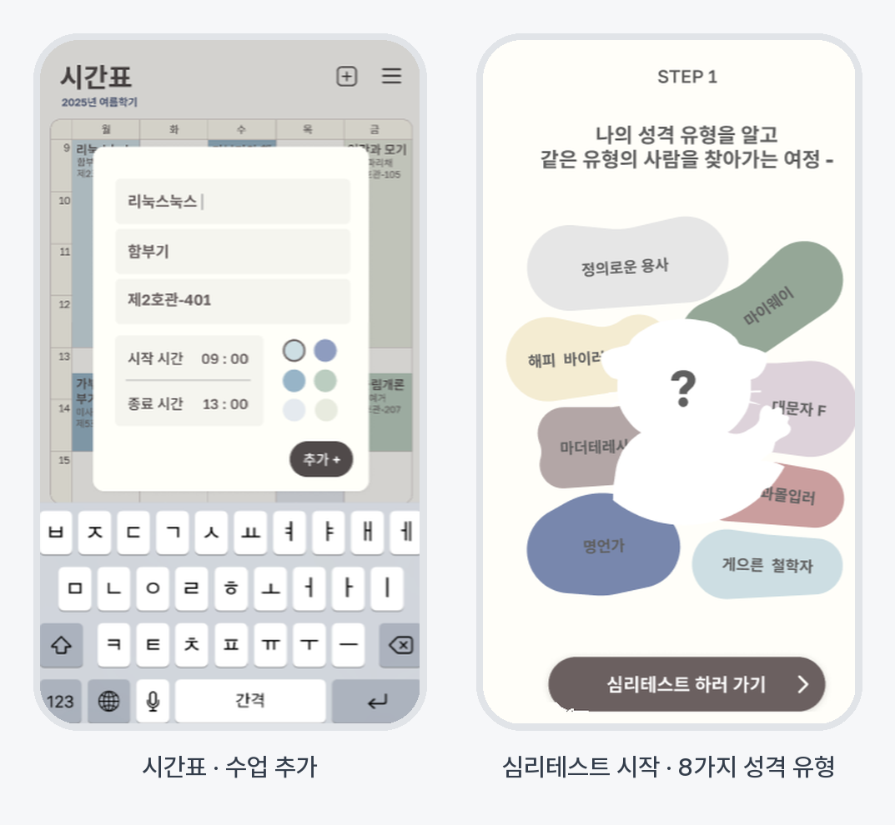 시간표에 수업 추가 · 심리테스트 시작 화면</td></tr>
</table>

> const::std 동아리 프로젝트 · 팀 SPORE(8인) · 담당: **백엔드(Firebase) · 친구 기능 · 프로필 · 구글 Play 스토어 배포** · 2025.05~2026.03

#### 📱 앱
심리테스트로 내 캐릭터를 찾고, 시간표 · 일정표 · 할 일을 관리하면서 친구와 시간표를 공유하는 Flutter 앱이에요. 테스트 완료나 친구 맺기 같은 활동에 타이틀을 주는 보상도 있어요.

#### 👥 담당 — 친구 기능과 Firestore 구조

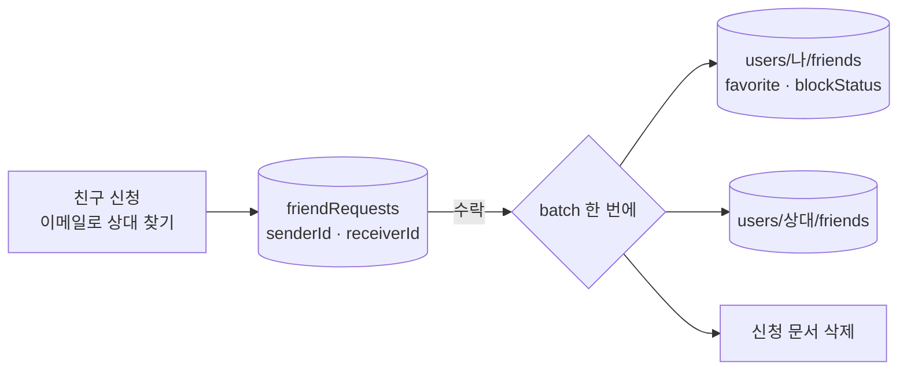

- 친구 신청 · 수락 · 거절 · 삭제 · 차단 흐름 구현, **받은 신청과 보낸 신청 목록이 섞여 보이던 버그**를 Firestore 구조를 바꿔 해결
- 신청은 `friendRequests` 컬렉션으로, 친구 관계는 각자의 `users/{uid}/friends` 하위 컬렉션으로 분리
- 수락할 때 **양쪽 친구 목록 추가와 신청 문서 삭제를 batch 한 번으로 묶어**, 중간에 실패해도 한쪽만 친구가 되는 상태가 생기지 않게
- 즐겨찾기 · 차단 여부를 친구 문서에 두어 목록에서 바로 거르도록 설계

#### 🙋 담당 — 프로필과 배포
- 프로필 편집 — 캐릭터 선택, 갤러리 권한 요청과 사진 변경, 한줄 소개(최소 글자 수 제한), 데이터베이스에서 캐릭터 ID 불러오기
- 알림 화면 정리, 시간표 색 조합 개선
- **구글 Play 스토어 배포** — 패키지 이름(`com.spore.app`) · 버전 관리 · 출시

**Stack** · Flutter · Dart · Firebase (Auth · Firestore · Functions) · Google Play

<b>🌿 이든길</b> — 서울시 교통 · 재난 위험 요소를 통합 분석한 안전 플랫폼

 

<table>
<tr><td> 행정안전부 보도자료를 매일 가져오는 make.com 자동화 워크플로</td></tr>
<tr><td align="center"> 자치구 교통사고 위험도 예측 모델(XGBoost)의 변수 중요도</td></tr>
</table>

> 지반침하 · 침수 · 도로 결빙 · 교통사고 같은 위험 요소를 한곳에서 보고, 커뮤니티로 정보를 나누는 웹 플랫폼 · 경북대학교 SW 파이썬 프로젝트 · 4인 팀 · 담당: **데이터 수집 · 전처리 · 분석(싱크홀 · 지반침하)**

- 서울시 자치구 기준으로 교통사고(2019~2023) · 신호등 · 횡단보도 · 인구 · 지반침하 · 상습 침수 · 도로 결빙 데이터를 수집 · 병합하고 좌표를 붙여 지도로 시각화
- 자치구별 교통사고 위험도를 XGBoost로 예측해 대시보드에 표시
- 행정안전부 API로 응급기관 254곳을 SQLite로 저장, 보도자료는 크롤러 + make.com 웹훅으로 매일 갱신
- 회의록으로 역할 분담 · 주간 목표 · 진행 상황을 관리

**Stack** · Python · pandas · GeoPandas · Folium · XGBoost · Django · SQLite · Selenium · make.com

 

## 🏆 Awards & Certifications

| 구분 | 내용 | 시기 |
|---|---|---|
| 🥉 수상 | 가비아 클릭엔 홈페이지 제작 **3위** | 2025.09 |
| 🏅 수상 | 데이콘 대구 빅데이터 분석 경진대회 **입상** | 2024.11 |
| 📜 자격 | 컴퓨터활용능력 2급 · 정보기기운용기능사 | |

 

## 📚 Education & Training

| 기간 | 기관 | 과정 | 내용 |
|---|---|---|---|
| 2023.03~2027.02 | 경북대학교 | 소프트웨어학과 | 학사 (졸업 예정) |
| 2026.08~2027.02 | iM뱅크 | iM DiGital Banker Academy 9기 | 금융 데이터분석 전문가 양성 |

 

## 🙋 Experience & Activities

| 기간 | 활동 |
|---|---|
| 2026.09~12 | **대구신용보증재단 재단지기 서포터즈** — 오프라인 팝업 운영 · 재단 인지도 조사, 30주년 사주 콘텐츠 제작 |
| 2026.03~12 | **부산디지털자산거래소 서포터즈** |
| 2026.03~08 | **카카오 Kanana AI 앰배서더** |
| 2026.03~07 | **삼성장학재단 AI 보조강사** — AI 수업 실습 지도 · 수업 운영 보조 |
| 2025.07~11 | **DX 캠프** — AI 소개팅 애플리케이션 「티가나」 기획 · 개발 · 투자 발표 |
| 2024.09~12 | **소프트웨어 모델링 멘토 · 멘티** — UML 기반 요구분석 · 설계 스터디 (아래 토글) |
| 2023~2025 | **const::std** — IT 개발 · 코딩 동아리, SPORE 앱 개발 · Play 스토어 출시 |

<b>📐 소프트웨어 모델링 멘토 · 멘티</b> — 요구분석 · 설계 단계에서 시스템을 UML로 시각화하는 법

 

> 소프트웨어 모델링은 요구분석 · 설계 단계에서 시스템을 시각화하는 과정으로, 주로 UML(Unified Modeling Language)을 사용해요

| 주제 | 세부 내용 |
|---|---|
| **요구분석** | 요구 추출, 사용 사례(유스케이스), 도메인 분석 |
| **모델링** | 정적 모델링(클래스 · 객체 다이어그램), 동적 모델링(시퀀스 다이어그램) |
| **설계** | 아키텍처 스타일, 디자인 패턴(팩토리 · 어댑터 등) |
| **프로세스** | 워터폴 · 애자일 모델, 프로젝트 계획 |

 

<b>🏙️ 3D Contributions · 🐍 Contribution Snake</b>

 

<picture>
  <source media="(prefers-color-scheme: dark)" srcset="https://raw.githubusercontent.com/Moomooti/Moomooti/output/github-snake-dark.svg" />
  
</picture>

