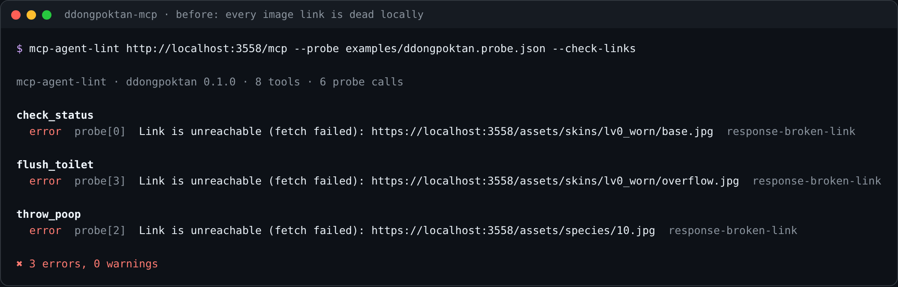
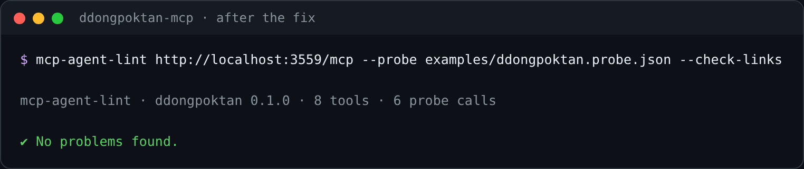
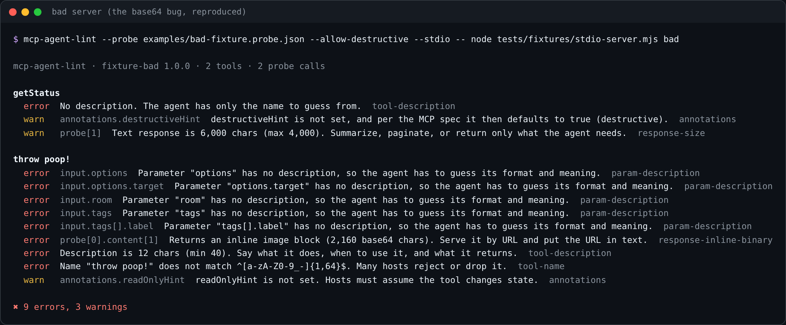
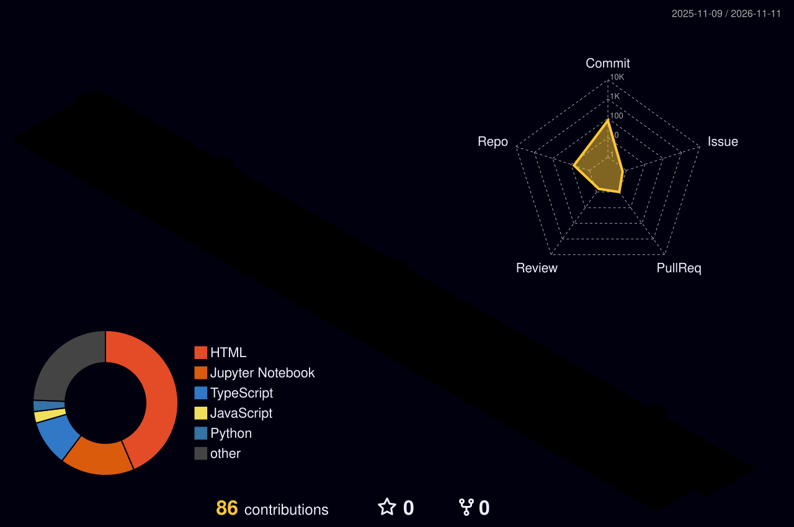

  

**AI 에이전트가 쓰는 인터페이스를 만들고, 그 품질을 테스트와 도구로 지키는 개발자입니다.** 
직접 겪은 장애를 재발 방지 도구로 만들고, 그 도구로 다시 제 서버의 버그를 찾아 고쳤어요.

🎓 경북대학교 소프트웨어학과 &nbsp;·&nbsp; 🏦 iM뱅크 데이터 분석 전문가 양성 아카데미 9기 &nbsp;·&nbsp; 📍 대구

 

## ⚙️ Tech Stack

| 분야 | 기술 |
|:---:|---|
| **Language** |    |
| **Server · Tooling** |       |
| **Quality · DevOps** |      |
| **AI · Data** |       |
| **Collaboration** |    |

 

## 🛠 Projects

| 기간 | 프로젝트 | 소속 | 역할 |
|---|---|---|---|
| 2026.07 | 💩 똥폭탄 MCP 서버 | 카카오 PlayMCP 공모전 | 서버 설계 · 개발 |
| 2026.08~10 | 🏦 FinHOLLY | iM뱅크 AI·블록체인 공모전 | 모델 학습 · 서빙 |
| 2026.09~10 | 📊 돈독 | iM뱅크 아카데미 9기 | 데이터 분석 |
| 2026.10~11 | 🔮 은퇴 소득 절벽 · 미리사주 | iM뱅크 아카데미 9기 | 데이터 · 모델링 (팀장) |
| 2026.10~11 | 🍲 바다거북 수프 추리 게임 | 개인 | 기획 · 개발 |
| 2026.11 | 🧧 대구신용보증재단 사주 | 대구신용보증재단 서포터즈 | 기획 · 개발 |
| 2026.11 | 🔍 mcp-agent-lint | 개인 | 설계 · 개발 |

▼ 프로젝트 이름을 누르면 상세 내용이 펼쳐집니다.

<b>🔍 mcp-agent-lint</b> — MCP 서버를 AI 에이전트의 눈으로 검사하는 CLI

<table>
<tr><td> 똥폭탄 서버를 처음 검사했을 때 — 로컬에서 이미지 링크가 전부 깨져 있었음</td></tr>
<tr><td> 수정 후 — 이제 똥폭탄 CI가 push마다 같은 검사를 돌림</td></tr>
</table>

> 똥폭탄 서버에서 겪은 장애를 다시 겪지 않으려고 만든 도구 · 사람이 화면으로 테스트하면 안 보이고, 에이전트가 실제로 호출해야 드러나는 문제를 잡아요

- 툴 목록 규칙 6개(이름 형식 · 설명 · 중첩 파라미터 설명 · annotation · 툴 개수)와 실제 호출 응답 규칙 5개(base64 인라인 · 응답 크기 · 빈 응답 · 예상 밖 오류 · 깨진 링크)
- **첫 실행에서 진짜 버그 발견** — 똥폭탄 서버가 프록시 헤더가 없으면 이미지 URL을 `https`로 고정해 로컬에서 모든 링크가 깨짐 → 수정하고, 똥폭탄 CI가 push마다 이 도구로 검사
- 실제 서버를 호출하는 도구라 안전장치부터 설계 — 파괴적일 수 있는 툴은 명시적 허용 없이 호출하지 않고, 없는 툴 · 잘못된 규칙 이름은 아무것도 호출하기 전에 실패
- 테스트 71개(규칙 단위 · 메모리 안 MCP 서버 · 실제 stdio/HTTP 프로세스), `strict` + `strictTypeChecked`, Node 20·22·24 CI에서 패키지로 설치한 CLI 실행까지 검증

**Stack** · TypeScript · Node.js · MCP SDK · zod · Vitest · ESLint · GitHub Actions

<b>💩 똥폭탄 MCP 서버</b> — 카카오톡 단톡방에서 AI 에이전트가 진행하는 게임

<table>
<tr><td width="34%"> 28종 똥 도감 · 10종 변기 스킨</td>
<td> 그때의 문제(응답 속 base64 이미지)를 재현해 mcp-agent-lint로 검사한 결과 — <code>response-inline-binary</code></td></tr>
</table>

> 카카오 PlayMCP 공모전 「Agentic Player 10」 출품작 · AI 에이전트가 호출하는 MCP 툴 8개를 설계·구현

- **장애 대응** — 툴 응답에 base64 이미지를 넣자 PlayMCP의 답변 생성이 실패. 가설 1(크기)로 이미지를 26MB → 2.9MB로 줄였지만 실패 → 가설 2(형식)로 이미지를 URL로 서빙해 해결
- **같은 그림도 받는 쪽에 맞게** — 에이전트(`/mcp`)에는 텍스트 속 URL, 카카오 채팅 화면(`/skill`)에는 정식 이미지 블록
- **재발 방지** — 실제 MCP 클라이언트로 붙는 계약 테스트(응답 1블록 · base64 금지 · 이미지 URL 유효성), DESIGN.md 명세 표를 읽어 코드와 대조하는 테스트 등 110개
- Stateless 서버 + Repository 패턴 + 방별 상태, 런타임 취약점 9개 → 0개, Dependabot · CI 취약점 검사

**Stack** · TypeScript · Express · MCP SDK · SQLite · Docker · Vitest · GitHub Actions

<b>🏦 FinHOLLY</b> — 은행 내부망에서만 도는 금융 특화 번역 AI

> 고객 정보를 외부 번역 API로 보낼 수 없는 은행 창구를 위해, 한국어 금융 문서를 동남아 5개 언어(베트남어 · 인도네시아어 · 태국어 · 필리핀어 · 미얀마어)로 내부망 안에서 번역 · iM뱅크 AI & 블록체인 공모전 출품작

- "청산 · 모집 · 사모"처럼 일반 번역기가 틀리는 금융 용어를 대조학습(SupCon)으로 구분
- 금융 어댑터와 언어 어댑터를 분리한 조합형 LoRA — 새 언어는 언어 어댑터만 학습
- LLM(EXAONE)으로 만든 학습 문장을 그대로 쓰지 않고 LaBSE로 저품질 쌍을 자동 제거, 학습에 없는 용어로 일반화 평가
- int8 양자화로 GPU 없이 CPU에서 문장당 0.1~0.3초, 더블클릭 설치 · 폐쇄망 오프라인 설치 · 웹페이지 제자리 번역 크롬 확장

**Stack** · Python · PyTorch · NLLB-200 · LoRA · CTranslate2 · Flask · Chrome Extension (MV3)

<b>📊 돈독 (Don-Ddok)</b> — 수출 경기 충격의 법인 계좌 전이 분석 · 기업금융 상품 매칭

<table><tr>
<td align="center"> 공식 수출 통계로 국면을 판정하는 트리거</td>
</tr></table>

> 지역 수출이 꺾이면 그 충격이 지방은행 법인 계좌에 언제, 어디에, 얼마나 나타나는지 통계로 검증하고, 영업 현장의 상품 상담 우선순위로 연결 · iM뱅크 익명 법인 데이터 11,036곳 × 36개월 
> **팀 결과**: 수출 증감률이 10%p 떨어지면 외환 노출 법인의 요구불예금이 6개월 뒤 약 3.6% 낮아짐 (Holm 보정 후에도 유의)

- 이중차분 · 국소투영 · 이중 군집 표준오차 · 성향점수매칭 · 위약 검정 · 최소검출효과까지 거친 검증
- 재검증에서 약해진 결과는 보고서에서 직접 철회 (예: 적립식 "보유 확률" 효과 p 0.015 → 0.565)
- 은행 데이터로 경기 둔화를 예측하는 신호가 위약 검정을 통과하지 못해, 공식 수출 통계를 트리거로 쓰는 구조로 전환
- 국면 × 페르소나 규칙으로 iM뱅크 기업상품 55개 중 최대 3개와 제안 문구를 고르는 매칭 모델

**Stack** · Python · pandas · statsmodels · 패널 회귀 · 규칙 기반 매칭(YAML)

<b>🔮 은퇴 소득 절벽 · 미리사주</b> — 지금은 괜찮은 50~69세 중 2년 뒤 빈곤선 아래로 떨어질 사람을 미리 찾는 머신러닝

<table><tr>
<td width="50%"> 미리사주 — 시작 화면</td>
<td width="50%"> 결과 — 위험 구간과 이유 3가지</td>
</tr></table>

> 기존 노후 진단이 '괜찮다'고 판정한 사람의 10.4%가 이후 빈곤선 아래로 반복해 떨어졌고, 그중 약 95%는 기초생활보장 수급 기록이 없었어요 · 4인 팀 · 담당: 팀장, 데이터 총괄 · 모델링

- 국가 패널 6개를 공통 스키마로 통합(학습 103,864행), 15종 모델 비교 후 LightGBM + 로지스틱 앙상블로 **AUC 0.811 → 0.870**
- 실험 전에 통과 기준을 사전 등록하고 그대로 판정, 보고서 설계도와 실제 코드가 맞는지 자동 검정(전체 26개 · 모델별 91개)
- 학습 모델과 배포 모델의 일치 시험(합성 300건), 라벨 셔플 · 학습곡선 · 하위 집단 · 패널 간 이식으로 "외운 게 아니라 배웠는지" 확인
- 20여 개 입력의 이탈을 줄이려 사주 콘셉트 웹서비스로 기획, Claude API 상담 챗봇이 대화에서 입력값을 채움 · A/B 테스트 후 SNS 하루 조회 600 · 좋아요 500

**Stack** · Python · LightGBM · scikit-learn · SHAP · FastAPI · Docker · Claude API

<b>🍲 바다거북 수프 추리 게임</b> — LLM이 사회자가 되는 예/아니오 추리 게임

<table><tr>
<td width="50%"> 수프 고르기</td>
<td width="50%"> 질문하며 수사하기</td>
</tr></table>

> 이상한 사건 하나가 주어지고, 예/아니오 질문만으로 진상을 맞히는 게임 · LLM이 진상을 알고 있는 사회자를 맡아요

- LLM이 자유롭게 말하지 않고 **정해진 JSON(답변 도장 · 열린 단서 번호 · 채점)으로만 답하게** 해서 판정이 화면과 정확히 맞물림
- JSON이 깨지면 본문에서 다시 추출하고, 그래도 안 되면 오류로 처리해 게임이 멈추지 않게
- 질문 35개 · 힌트 3개 · 핵심 단서 6칸 규칙, 이어하기와 사건 노트는 브라우저에만 저장, 큰 글씨 · 효과 끄기 접근성 옵션

**Stack** · HTML · CSS · JavaScript · Claude · Gemini (Apps Script 중계)

<b>🧧 대구신용보증재단 사주</b> — 재단의 30년을 사주로 풀어낸 SNS 홍보 콘텐츠

<table><tr>
<td width="50%"> 재단의 30년을 네 기둥으로</td>
<td width="50%"> 7문항 사업가 테스트 결과</td>
</tr></table>

> 딱딱한 기관 실적은 SNS에서 끝까지 읽히지 않아서, 1996년에 세워진 재단을 "올해 서른 살이 된 아이"로 보고 사주 캐릭터가 30년을 풀어 주는 콘셉트로 기획

- 한 화면에 한 장면 — 스크롤 없이 버튼으로 넘기고, 360×640 작은 휴대폰 화면까지 확인
- 읽고 끝나지 않게 7문항 사업가 테스트로 이어서, 유형별 재단 지원 키워드와 카카오톡 채널로 연결
- 답변은 저장하지 않고 브라우저 안에서만 계산, 링크 공유 미리보기 카드 지원

**Stack** · HTML · CSS · JavaScript · GitHub Pages

 

## 🏆 Awards & Certifications

| 구분 | 내용 | 시기 |
|---|---|---|
| 🥉 수상 | 가비아 클릭엔 홈페이지 제작 **3위** | 2025.09 |
| 🏅 수상 | 데이콘 대구 빅데이터 분석 경진대회 **입상** | 2024.11 |
| 📜 자격 | 컴퓨터활용능력 2급 · 정보기기운용기능사 | |

 

## 📚 Education & Training

| 기간 | 기관 | 과정 | 내용 |
|---|---|---|---|
| 2023.03~2027.02 | 경북대학교 | 소프트웨어학과 | 학사 (졸업 예정) |
| 2026.08~2027.02 | iM뱅크 | iM DiGital Banker Academy 9기 | 금융 데이터분석 전문가 양성 |

 

## 🙋 Experience & Activities

| 기간 | 활동 |
|---|---|
| 2026.09~12 | **대구신용보증재단 재단지기 서포터즈** — 오프라인 팝업 운영 · 재단 인지도 조사, 30주년 사주 콘텐츠 제작 |
| 2026.03~12 | **부산디지털자산거래소 서포터즈** |
| 2026.03~08 | **카카오 Kanana AI 앰배서더** |
| 2026.03~07 | **삼성장학재단 AI 보조강사** — AI 수업 실습 지도 · 수업 운영 보조 |
| 2025.07 | **DX 캠프** — AI 소개팅 애플리케이션 기획 · 투자 발표 |

 

<b>🏙️ 3D Contributions · 🐍 Contribution Snake</b>

 

<picture>
  <source media="(prefers-color-scheme: dark)" srcset="https://raw.githubusercontent.com/Moomooti/Moomooti/output/github-snake-dark.svg" />
  
</picture>

